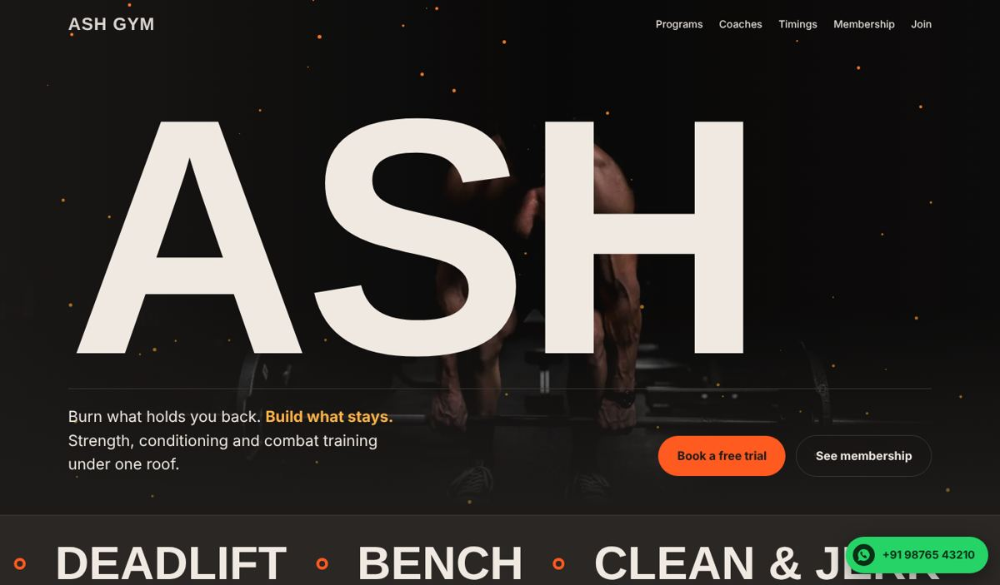
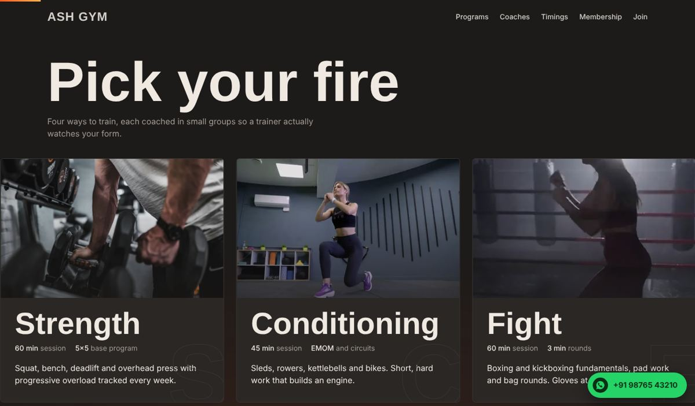
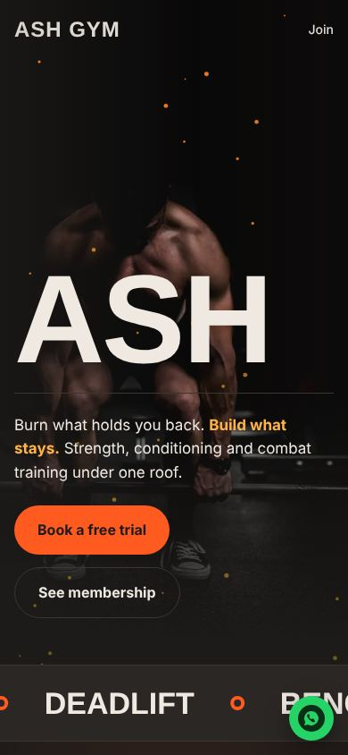
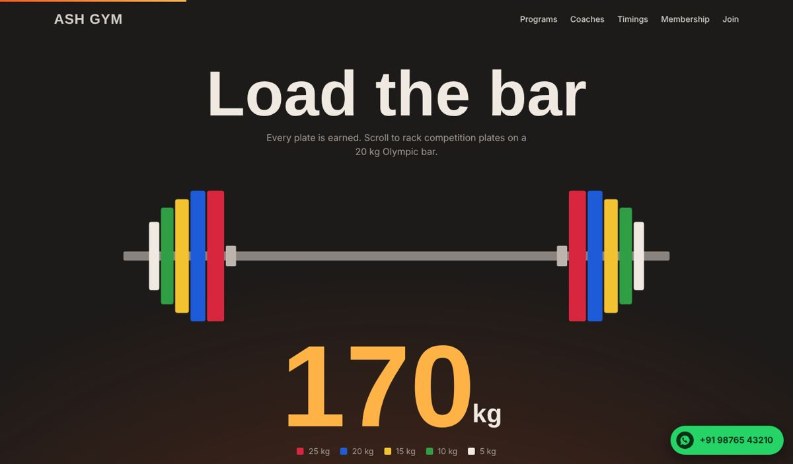
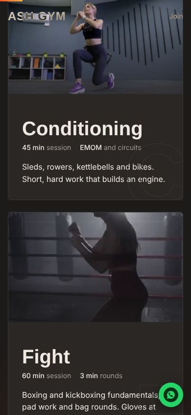
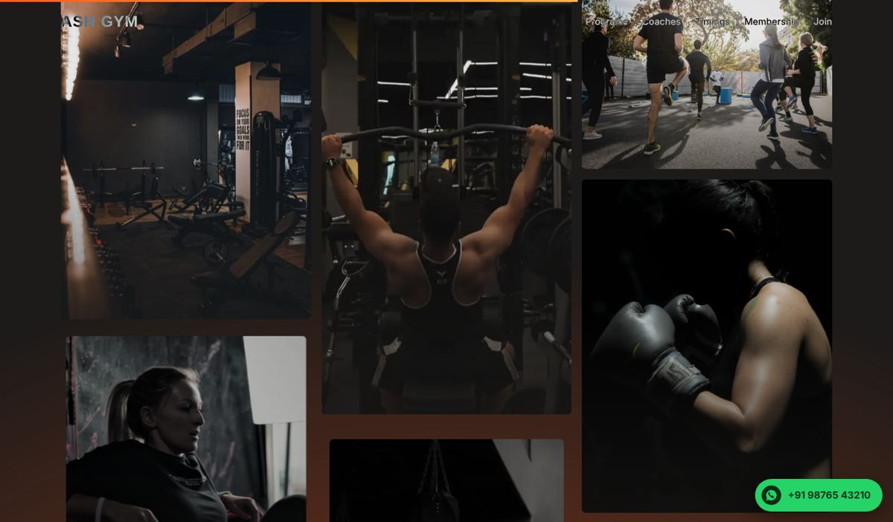

# ASH GYM — Scroll-Animated Gym Website

A concept website for a fictional gym brand, **ASH GYM**, built as a front-end showcase project. The whole page is a scroll-driven story: the background starts as cold ash and heats up to ember orange as you scroll, photos fade in from grey to colour, and a barbell loads itself plate by plate.

> **Note:** ASH GYM, its coaches, prices and contact details are fictional. This is a portfolio project, not a real business.



## Features

| Section | What happens on scroll |
|---|---|
| Hero | "ASH" letters break apart and turn to fire colours, ember particles rise faster, background photo zooms out |
| Programs | Cards pin and slide horizontally on desktop; the Conditioning and Fight cards play looping video |
| Load the bar | Section pins while competition plates slide onto a 20 kg Olympic bar and the counter climbs to 170 kg |
| Facilities | Each line lights up as it crosses the middle; a side panel swaps to the matching photo (desktop) |
| Coaches | Coach cards stack on top of each other while the section is pinned |
| First 12 weeks | Timeline bar fills and each milestone lights up |
| Gallery | Three columns move at different speeds (parallax), photos and videos warm from grey to colour |
| Timings, plans, FAQ | Rows and cards rise in with the scroll |
| BMI calculator | Gauge arcs draw in; needle swings to the result |
| Join form | Fields slide in one by one; validated in the browser with an in-page confirmation |

Other details:
- Scroll progress bar and a page-wide heat glow that grows as you go down
- Floating WhatsApp button
- Fully responsive. Phones get lighter animations with only two pinned sections.
- Respects `prefers-reduced-motion`: animations and video autoplay turn off, and all content stays visible
- Videos only play while on screen, and the ember canvas pauses when the hero is out of view

## Tech stack

- **HTML, CSS, vanilla JavaScript.** One file, no build step.
- **[GSAP 3.12.5](https://gsap.com/) + ScrollTrigger** for scroll-driven animation (loaded from cdnjs)
- **Canvas 2D** for the ember particles
- **Inline SVG** for the barbell and the BMI gauge
- **Google Fonts:** Big Shoulders Display (headings) and Archivo (body)

## Project structure

```
ash-gym/
├── index.html          # the whole site: markup, styles and scripts
├── img/                # compressed photos (.webp) and videos (.mp4) with posters
├── docs/
│   ├── DESIGN.md       # design tokens, type scale, animation map
│   └── screenshots/    # images used in this README
├── README.md
├── CHANGELOG.md
├── CREDITS.md
├── LICENSE
└── .gitignore
```

## Run it locally

Because the page loads its videos and images by relative path, serve the folder instead of double-clicking the file:

```bash
# Python
python -m http.server 8000

# or Node
npx serve .
```

Then open `http://localhost:8000`.

## Deploy

**GitHub Pages:** push this folder to a repository, go to *Settings → Pages*, choose the `main` branch and the root folder.

**Netlify:** drag and drop the folder onto [app.netlify.com/drop](https://app.netlify.com/drop).

## Customise

All contact details live in one object at the top of the main `<script>` in `index.html`:

```js
const GYM = {
  whatsapp:   "",                 // digits with country code, e.g. "919876543210"
  phoneLabel: "+91 98765 43210",  // how the number is shown
  address:    "2nd Floor, Forge House, 14 Station Road",
  instagram:  "@ash.gym",
  mapsLink:   ""                  // full Google Maps link; the button hides when empty
};
```

- Set `whatsapp` to enable the floating button and the "Send on WhatsApp" step after the join form. It is empty on purpose in this showcase so visitors don't message a real number by accident.
- Prices, timings, coaches and facilities are plain HTML. Search for the section `id` (`#plans`, `#schedule`, `#trainers`, `#facilities`).
- Colours and fonts are CSS variables in `:root` at the top of the `<style>` block.

## Screenshots

| Desktop | Mobile |
|---|---|
|  |  |
|  |  |
|  | |

## Performance

- 20 media files, about 1.9 MB in total (photos as WebP at 1000 px, videos re-encoded to 540 px H.264 with no audio)
- Videos use `preload="none"` and start only when scrolled into view
- Device pixel ratio for the canvas is capped at 2

## Credits and license

- Code: MIT, see [LICENSE](LICENSE)
- Photos and videos: free stock media, see [CREDITS.md](CREDITS.md)

Designed and built by **Yash Pathak**.
